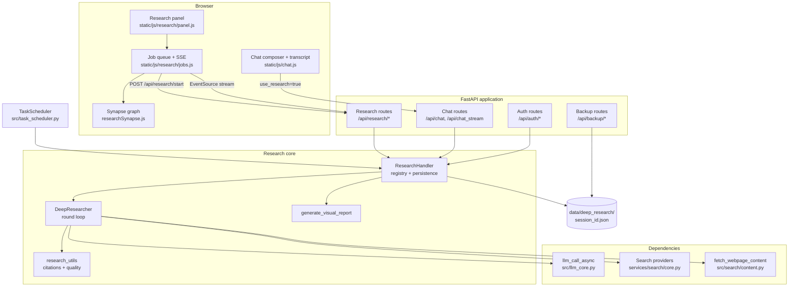
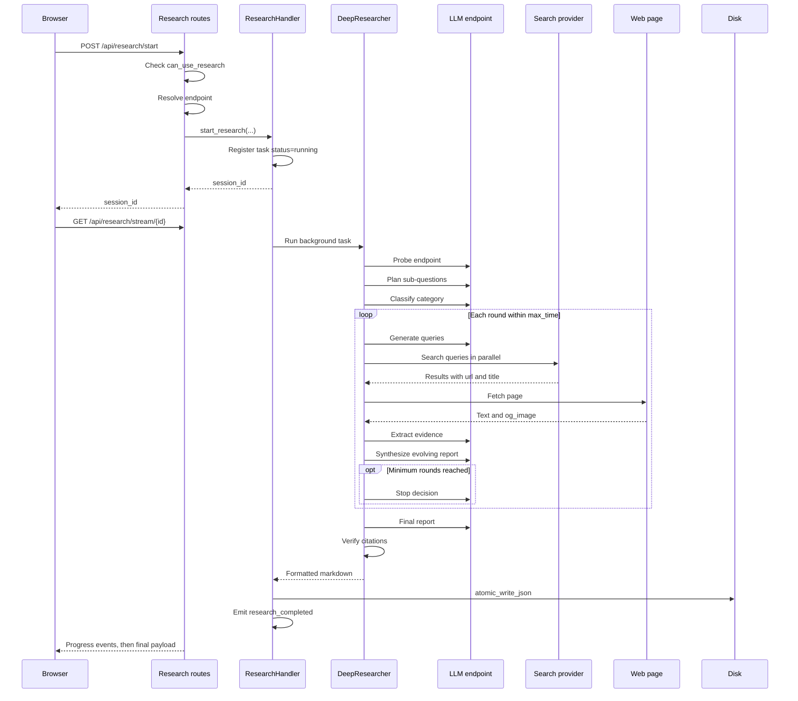
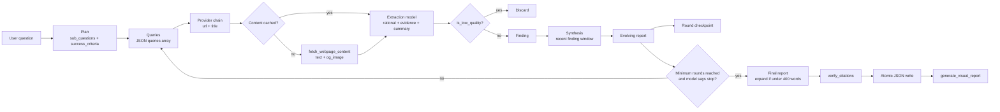
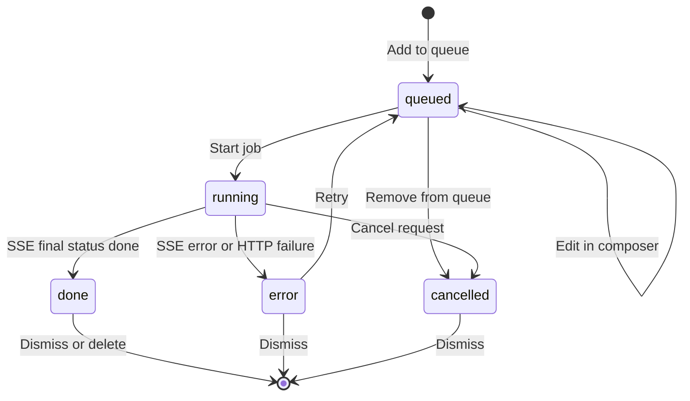
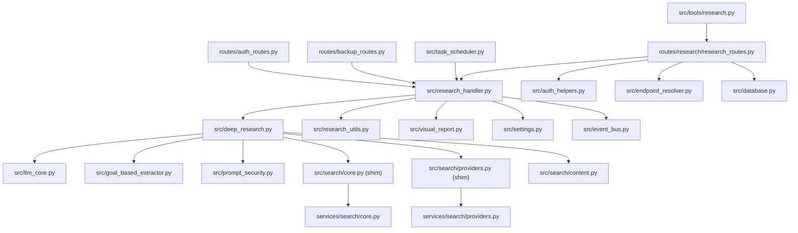

Deep Research is the multi-round web research subsystem in Zephyrus. A job plans an investigation, generates search queries, fetches pages, extracts evidence, rewrites a working report each round, decides when it has enough, and compiles a final report with inline citations. The finished report is saved as JSON, rendered as a standalone HTML visual report, and listed in the Library.

A single search pass answers a lookup. A question that requires comparison, cross-source verification, or synthesis benefits from later queries that build on earlier results, so Deep Research runs a structured loop:

```text
Plan -> Think -> Search -> Extract -> Synthesize -> Decide -> Report
```

The pipeline, including planning, extraction, synthesis, stopping decisions, citation checks, persistence, visual reports, and cancellation, is implemented and covered by automated tests.

## Terminology

| Term            | Meaning                                                                                                                            |
| --------------- | ---------------------------------------------------------------------------------------------------------------------------------- |
| Job or run      | One execution of the research loop, identified by a session id.                                                                    |
| Session id      | `rp-` plus 12 hex characters from the panel, the chat session id, or the scheduler task id.                                        |
| Round           | One pass of query generation, search, extraction, and synthesis. Rounds start at 1.                                                |
| Plan            | The query decomposition into sub-questions, topics, and success criteria.                                                          |
| Query           | One search string generated during a round.                                                                                        |
| Finding         | Extracted source data with `rational`, `evidence`, `summary`, `url`, `title`, and `og_image`.                                      |
| Source          | A finding reduced to `{url, title, image}` and deduplicated by URL.                                                                |
| Evolving report | The working draft rewritten after each round. It feeds the stop decision and the final report.                                     |
| Category        | Output format: `product`, `comparison`, `howto`, `factcheck`, or general. The panel also lists Landscape.                          |
| Phase           | Current execution state: `probing`, `planning`, `searching`, `reading`, `analyzing`, `writing`, `deciding`, `warning`, or `error`. |
| Synapse         | The SVG graph in the panel that shows query roots, round branches, and source leaves.                                              |
| Consumed        | A report fetched through the result endpoint. It stays on disk but drops out of status views.                                      |
| Checkpoint      | A round snapshot written to a `.checkpoint` file so a timeout can salvage the draft.                                               |
| Ephemeral run   | An in-memory job, such as one started from an incognito chat, that is never saved to disk and is purged after 300 seconds.         |
| Time reserve    | Part of the `max_time` budget held back for the final report and citation checks.                                                  |

## Core capabilities

| Capability                  | Status      | Description                                                                                                     |
| --------------------------- | ----------- | --------------------------------------------------------------------------------------------------------------- |
| Multi-round research loop   | Implemented | `DeepResearcher.research` runs planning, search, extraction, synthesis, and stopping.                           |
| Query planning              | Implemented | `_create_plan` generates sub-questions, key topics, and success criteria before the first search.               |
| Dynamic query generation    | Implemented | Each round generates new queries from current findings and drops duplicates.                                    |
| Search provider chain       | Implemented | Searches SearXNG, DuckDuckGo, Brave, Tavily, Google, or Serper with fallbacks.                                  |
| Bounded parallel extraction | Implemented | Page fetches run in parallel, with concurrency capped by `asyncio.Semaphore`.                                   |
| Shared endpoint semaphores  | Implemented | `ResearchHandler._shared_semaphore` pools semaphores per endpoint so parallel jobs respect one concurrency cap. |
| Quality filtering           | Implemented | `is_low_quality` drops navigation text, cookie banners, access blocks, and empty summaries.                     |
| Verified citations          | Implemented | `verify_citations` checks link targets against analyzed sources and preserves markdown images.                  |
| Format classification       | Implemented | Classifies reports as product, comparison, how-to, or fact-check.                                               |
| Model-guided stopping       | Implemented | The model evaluates coverage after the minimum round count.                                                     |
| Length validation           | Implemented | A final draft under 400 words triggers an expansion call.                                                       |
| Multi-turn continuation     | Implemented | Accepts `prior_report`, `prior_findings`, and `prior_urls`, and skips pages already visited.                    |
| Background task registry    | Implemented | Jobs run independently of browser connections and survive page refreshes.                                       |
| Live SSE stream             | Implemented | Server-Sent Events deliver phase, round, query, and source updates.                                             |
| Round checkpoints           | Implemented | `.checkpoint` files store in-progress state after each round.                                                   |
| Partial result salvage      | Implemented | A timeout or error finalizes the evolving draft when evidence exists.                                           |
| Ephemeral runs              | Implemented | Incognito jobs stay in memory and are purged after 300 seconds.                                                 |
| Memory reaper               | Implemented | Finished task entries expire after a TTL, and retention purges run on a schedule.                               |
| Visibility-aware polling    | Implemented | The client pauses polling when the tab is hidden and resumes on focus.                                          |
| User isolation              | Implemented | Reports are scoped by owner, and cross-owner lookups return 404.                                                |
| HTML visual report          | Implemented | Standalone reports with hero images, a metrics bar, and a source drawer.                                        |
| Report Library              | Implemented | Search, filter, sort, archive, and delete saved reports.                                                        |
| Chat spinoff                | Implemented | Starts a new chat seeded with a completed report.                                                               |
| Agent tool integration      | Implemented | `trigger_research` and `manage_research` allow autonomous runs with owner scoping.                              |
| Scheduled research          | Implemented | The task scheduler runs unattended jobs through `ResearchHandler`.                                              |
| Backup and restore          | Implemented | User reports are exported and imported with owner metadata.                                                     |
| Account deletion cleanup    | Implemented | Deleting a user removes their reports and checkpoints and cancels active tasks.                                 |

## Architecture

Deep Research separates orchestration, execution, storage, and presentation:

- **Research engine (`src/deep_research.py`):** `DeepResearcher` runs the loop, executes prompt templates, parses model output, calls search providers, and extracts page content. It does not know about HTTP sessions, user accounts, or report files.
- **Task handler (`src/research_handler.py`):** `ResearchHandler` owns the in-memory task registry, background `asyncio` tasks, checkpoint and report persistence, shared semaphores, timeouts, salvage, and cleanup.
- **HTTP routes (`routes/research/research_routes.py`):** Provide `/api/research/*`, with authentication, permissions, validation, SSE streaming, and ownership checks.
- **Utilities (`src/research_utils.py`):** Citation verification and quality checks.
- **Visual report generator (`src/visual_report.py`):** Turns a markdown report and source metadata into a standalone HTML document.
- **Frontend controllers (`static/js/research/*`):** Render the panel, job queue, progress stream, synapse graph, and Library.

### Source layout

| Layer                                    | Path                                    |
| ---------------------------------------- | --------------------------------------- |
| Research engine loop                     | `src/deep_research.py`                  |
| Citation and quality utilities           | `src/research_utils.py`                 |
| Job registry, lifecycle, and persistence | `src/research_handler.py`               |
| HTTP routes                              | `routes/research/research_routes.py`    |
| Legacy route shim                        | `routes/research_routes.py`             |
| HTML report generator                    | `src/visual_report.py`                  |
| Extraction prompts                       | `src/goal_based_extractor.py`           |
| Agent tools                              | `src/tools/research.py`                 |
| Web UI panel                             | `static/js/research/panel.js`           |
| Web UI job state machine                 | `static/js/research/jobs.js`            |
| Synapse visualization                    | `static/js/researchSynapse.js`          |
| Scheduled tasks                          | `src/task_scheduler.py`                 |
| Service facade                           | `services/research/service.py`          |
| Service handler facade                   | `services/research/research_handler.py` |

### System diagram



### Boundaries

- The engine accepts endpoint configuration and emits progress callbacks. It has no database or filesystem access.
- The handler owns tasks, semaphores, checkpoints, and files. Routes own authentication, validation, and response shaping.
- The server keeps authoritative state. The client caches active jobs and stores dismissed cards in `localStorage`.
- The route and handler layers filter by the authenticated `owner` username, so tenant separation does not depend on the UI.

### Design decisions

1. **Background task registry:** `start_research` creates an `asyncio.Task` and returns a session id immediately. Closing the browser does not stop the job. The client reattaches through `/api/research/active` and the SSE stream.
2. **Two time budgets:** The engine checks a cooperative `max_time` between rounds. An external `research_run_timeout_seconds` ceiling wraps the task in `asyncio.wait_for`.
3. **Shared endpoint concurrency:** Semaphores are keyed by endpoint and reused across jobs, which keeps concurrent runs from overloading a local model server.
4. **Salvage on failure:** A timeout or unhandled error after at least one synthesis round finalizes the draft instead of returning an empty report.
5. **Untrusted content framing:** Fetched page text passes through `untrusted_context_message` from `src/prompt_security.py` and is sent as user data, never appended to system instructions.

## Execution lifecycle

### Sequence



### Stage details

<Steps>
  <Step title="1. Admission and privilege check">
    `/api/research/start` requires identity and the `can_use_research` privilege. Requests from internal agent tools authenticate with `X-Zephyrus-Owner`, and the handler validates that header against the user's permissions.
  </Step>

<Step title="2. Endpoint resolution">
  The system checks an explicit request override, `research_endpoint_id`, the `utility`
  endpoint, the default workspace endpoint, the chat endpoint, and the user's first
  enabled endpoint, in that order.
</Step>

<Step title="3. Registration">
  `ResearchHandler` records the job in `_active_tasks` with status `running` and creates
  cancellation events.
</Step>

<Step title="4. Endpoint probe">
  A short call checks that the model responds and that credentials work. A failed probe
  halts the run before it uses search quota and returns an error that names the endpoint
  setting to check.
</Step>

<Step title="5. Strategy planning">
  `_create_plan` runs `RESEARCH_PLAN_PROMPT`. The model breaks the question into
  sub-questions, key topics, and a success criterion. The flattened plan is injected into
  later query calls.
</Step>

<Step title="6. Category classification">
  A zero-temperature call assigns `product`, `comparison`, `howto`, or `factcheck`. The
  category adds formatting rules to the final report. Other queries use the general
  format.
</Step>

  <Step title="7. Round loop">
    Each round has five phases:

    - **Think:** The model sees the plan, findings so far, and the round number, then returns search queries.
    - **Search:** Queries run in parallel through the provider chain.
    - **Extract:** Unseen URLs are fetched in worker threads, up to 15,000 characters each, and the model returns a rationale, evidence, and a summary under a shared semaphore.
    - **Filter:** `is_low_quality` drops boilerplate and empty summaries.
    - **Synthesize:** The model folds the new findings into the evolving report.

  </Step>

<Step title="8. Stop decision">
  At `research_min_rounds` and later, `_should_stop` asks the model whether the evidence
  answers the question. The model returns a JSON decision with a coverage score and
  missing gaps. A leading YES or NO also works, so a model that ignores the JSON schema
  still stops the loop.
</Step>

<Step title="9. Final report">
  `FINAL_REPORT_PROMPT` receives the findings, citations, and category rules. It returns a
  structured markdown report with inline links. A draft under 400 words triggers an
  expansion call at a higher temperature.
</Step>

<Step title="10. Citation verification">
  `verify_citations` compares report links with analyzed sources. Links that do not match
  a source are removed. Markdown images, which use ``, are left intact.
</Step>

  <Step title="11. Persistence and event">
    The handler adds a summary header with duration, rounds, queries, and analyzed URLs. It writes the record with `atomic_write_json` and mode `0600`, emits `research_completed` on the internal bus, and closes the SSE stream.
  </Step>
</Steps>

### Continuation runs

A finished report can seed another investigation:

- The new job accepts `prior_report`, `prior_findings`, and `prior_urls`.
- URLs from the earlier run are excluded from extraction, so the job does not fetch the same pages again.
- The planner receives prior conclusions and focuses queries on the remaining gaps.

### Stopping conditions

The loop ends on the first condition that applies:

| Trigger                    | Check point        | Result                                                                                |
| -------------------------- | ------------------ | ------------------------------------------------------------------------------------- |
| Cancellation requested     | Start of round     | Stops and returns the current draft.                                                  |
| Cooperative budget reached | Before a new round | The loop exits when elapsed time plus the final-report reserve exceeds `max_time`.    |
| No queries generated       | Query generation   | The model returned no usable queries, so the loop exits.                              |
| Consecutive empty rounds   | After extraction   | Two rounds with no new URLs end the loop.                                             |
| Model stop decision        | End of round       | Stops when the round count is at least `research_min_rounds` and the model says stop. |
| Round cap                  | End of round       | Stops at `max_rounds`.                                                                |
| Hard task timeout          | Global ceiling     | `asyncio.wait_for` fires and salvages the draft if one exists.                        |

### Budgets and timeouts

| Budget                   | Default  | Setting                                 | Enforcement                                              |
| ------------------------ | -------- | --------------------------------------- | -------------------------------------------------------- |
| Cooperative round budget | 300 s    | Request `max_time`                      | Checked between rounds.                                  |
| Final report reserve     | 45 s     | `research_final_report_reserve_seconds` | Subtracted from `max_time` before a round starts.        |
| Wall-clock limit         | 1800 s   | `research_run_timeout_seconds`          | `asyncio.wait_for` around the task. Set to 0 to disable. |
| Endpoint probe           | 15 s     | Fixed                                   | Per request.                                             |
| Category classification  | 15 s     | Fixed                                   | Per request.                                             |
| Query planning           | 90 s     | `research_planning_timeout_seconds`     | Per request.                                             |
| Query generation         | 90 s     | `research_query_timeout_seconds`        | Per request.                                             |
| Page extraction          | 90 s     | `research_extraction_timeout_seconds`   | Per request.                                             |
| Report synthesis         | 180 s    | Fixed                                   | Per request.                                             |
| Final report             | 180 s    | Fixed                                   | Per request.                                             |
| Stop decision            | 60 s     | Fixed                                   | Per request.                                             |
| Content cache TTL        | 86400 s  | `research_extraction_cache_ttl_seconds` | Reused across overlapping runs.                          |
| Report retention         | 0 (keep) | `research_retention_days`               | Purge sweep every 6 hours.                               |

## Data and storage

### Flow



### Finding schema

```json
{
  "rational": "Why this source matters to the research goal",
  "evidence": "Quoted or closely paraphrased passage from the page",
  "summary": "Short synthesis of the facts",
  "url": "https://example.com/source-page",
  "title": "Page title from search metadata or the HTML head",
  "og_image": "https://example.com/social-preview.jpg"
}
```

### Stored report schema

Completed reports live in `data/deep_research/<session_id>.json`. Checkpoints use the `.checkpoint` extension and are excluded from Library listings. Streaming providers can emit `{"type": "usage", "data": {...}}` events, and `src/llm_core.py` parses them into the `stats.tokens` block, including per-stage totals.

```json title="data/deep_research/<session_id>.json"
{
  "query": "Research question string",
  "status": "done",
  "result": "## Research Summary\n- **Duration:** 3m 12s\n- **Rounds:** 4\n- **Queries:** 11\n- **URLs Analyzed:** 12\n- **Model:** model-name\n\n# Report title\n...",
  "raw_report": "Direct output from the final report call",
  "sources": [
    {
      "url": "https://example.com/article",
      "title": "Article title",
      "image": "https://example.com/preview.jpg"
    }
  ],
  "raw_findings": [
    {
      "url": "https://example.com/article",
      "title": "Article title",
      "summary": "Extracted summary text"
    }
  ],
  "stats": {
    "Duration": "3m 12s",
    "Rounds": 4,
    "Queries": 11,
    "URLs": 12,
    "Model": "model-name",
    "Search": "searxng",
    "Tokens": 14200,
    "tokens": {
      "prompt_tokens": 10500,
      "completion_tokens": 3700,
      "total_tokens": 14200,
      "llm_calls": 9,
      "by_stage": {
        "plan": { "prompt_tokens": 650, "completion_tokens": 280, "llm_calls": 1 },
        "query": { "prompt_tokens": 2100, "completion_tokens": 420, "llm_calls": 3 },
        "extract": { "prompt_tokens": 4800, "completion_tokens": 1200, "llm_calls": 6 },
        "synthesize": { "prompt_tokens": 1850, "completion_tokens": 900, "llm_calls": 2 },
        "decide": { "prompt_tokens": 1100, "completion_tokens": 150, "llm_calls": 2 },
        "final": { "prompt_tokens": 1600, "completion_tokens": 750, "llm_calls": 1 }
      }
    },
    "citations": {
      "citations_total": 8,
      "citations_verified": 7,
      "citations_stripped": 1
    }
  },
  "category": "comparison",
  "started_at": 1732300000.0,
  "completed_at": 1732300192.0,
  "owner": "username",
  "ephemeral": false,
  "archived": false,
  "consumed": false,
  "hidden_images": []
}
```

## Client state machine



## Entry points

### Deep Research panel

The panel opens as the modal `#research-overlay` from the navigation rail (`#rail-research`) or the sidebar button (`#tool-research-btn`).

- **Query input:** The main topic or investigation question.
- **Rounds:** Auto (up to 20 rounds) or a fixed cap from 1 to 20.
- **Format:** Auto, Product, Compare, How-to, Landscape, or Fact-check.
- **Time budget:** Quick (2 minutes), Standard (5 minutes), Deep (15 minutes), or a custom value from 1 to 30 minutes.
- **Search provider:** The system default, SearXNG, DuckDuckGo, Tavily, Brave, Google, or Serper.
- **Model and endpoint:** An override for the research backend.
- **Batch queue:** Multiple queries can run in parallel or one after another.
- **Progress:** Elapsed time, current round, source counts, a synapse graph, and progress bars driven by `max_rounds` and `max_time`.
- **Completion actions:** Visual Report, Discuss in Chat, Continue Investigation, Copy Markdown, and Delete.

The overlay is a dialog with `role="dialog"`, `aria-modal="true"`, `aria-labelledby`, and a keyboard focus trap. The layout adjusts for small screens.

### Chat sessions

Chat can start research directly. When a user asks a question that needs it:

1. The model may ask a short clarifying question about scope.
2. The server turns the conversation into a targeted research query.
3. Progress events stream into the chat while the job runs.
4. The finished report, collapsible sources, and raw findings become an assistant message.
5. A follow-up in the same session reuses prior findings and skips visited URLs.

The inline `POST /api/chat` path runs research synchronously and is time-bounded to stay under proxy timeouts. Incognito sessions skip transcript write-back, and jobs from those sessions stay in memory.

### Agent tools

Agents use two tools from `src/tools/research.py`:

- `trigger_research(topic, max_rounds, category, search_provider)` starts a background run and returns a link to it.
- `manage_research(action, session_id, query)` supports `list`, `read`, and `delete`. Results are filtered by the current owner.

```json title="Agent tool call"
{
  "tool": "trigger_research",
  "arguments": {
    "topic": "Compare ClickHouse and DuckDB for real-time analytical workloads",
    "category": "comparison",
    "max_rounds": 6
  }
}
```

### Scheduled tasks

`TaskScheduler._execute_research_task` runs jobs with `task_type="research"`. It delegates to `ResearchHandler.start_research` and awaits the task handle, so scheduled runs get endpoint probing, the wall-clock limit, cancellation, and error salvage. If the job ends with status `error`, the scheduler raises a `RuntimeError` so the run is recorded as failed. Finished reports use the `scheduled` category tag.

### HTTP API

The routes file exposes 15 endpoints.

| Method   | Endpoint                           | Purpose                                       | Access             |
| -------- | ---------------------------------- | --------------------------------------------- | ------------------ |
| `POST`   | `/api/research/start`              | Start a background job.                       | `can_use_research` |
| `GET`    | `/api/research/active`             | List running jobs for the caller.             | Authenticated      |
| `GET`    | `/api/research/status/{id}`        | Read status and metrics.                      | Owner              |
| `GET`    | `/api/research/stream/{id}`        | Stream progress with SSE.                     | Owner              |
| `POST`   | `/api/research/cancel/{id}`        | Cancel an active job.                         | Owner              |
| `POST`   | `/api/research/result/{id}`        | Fetch the report and mark it consumed.        | Owner              |
| `POST`   | `/api/research/result-peek/{id}`   | Fetch the report without marking it consumed. | Owner              |
| `GET`    | `/api/research/report/{id}`        | Render the standalone HTML report.            | Owner              |
| `GET`    | `/api/research/library`            | Search, sort, and page saved reports.         | Owner              |
| `GET`    | `/api/research/detail/{id}`        | Read the raw JSON record.                     | Owner              |
| `POST`   | `/api/research/{id}/archive`       | Toggle the archive flag.                      | Owner              |
| `DELETE` | `/api/research/{id}`               | Delete the JSON file.                         | Owner              |
| `POST`   | `/api/research/spinoff/{id}`       | Start a chat seeded with the report.          | Owner              |
| `POST`   | `/api/research/{id}/hide-image`    | Hide one image in the visual report.          | Owner              |
| `POST`   | `/api/research/{id}/unhide-images` | Restore hidden images.                        | Owner              |

#### Start and stream

```bash title="Start research"
curl -X POST http://localhost:7000/api/research/start \
  -H "Content-Type: application/json" \
  -b "session=<auth-cookie>" \
  -d '{
    "query": "Evaluate state of WebGPU support across modern browsers in 2026",
    "max_rounds": 6,
    "max_time": 900,
    "category": "factcheck"
  }'
```

```json title="Response"
{
  "session_id": "rp-3a8f19c0b2d4",
  "status": "running",
  "query": "Evaluate state of WebGPU support across modern browsers in 2026"
}
```

```bash title="Listen to progress"
curl -N http://localhost:7000/api/research/stream/rp-3a8f19c0b2d4 \
  -b "session=<auth-cookie>"
```

```text title="SSE output"
data: {"phase": "probing", "model": "qwen2.5:32b", "status": "running"}
data: {"phase": "planning", "status": "running"}
data: {"phase": "searching", "round": 1, "queries": 4, "query_preview": "WebGPU browser support 2026 status", "status": "running"}
data: {"phase": "reading", "url": "https://caniuse.com/webgpu", "title": "WebGPU support", "status": "running"}
data: {"phase": "writing", "status": "running"}
data: {"status": "done", "final": true}
```

## Visual reports and Library

### HTML visual reports

`GET /api/research/report/{id}` renders a completed run as a standalone HTML page.

- **Title:** The first markdown heading, with the research query as the fallback.
- **Structure:** Single bold lines become section headings when the markdown has no `##` structure. Table-of-contents anchors and code blocks are formatted as well.
- **Images:** The generator reads Open Graph images from cited pages and skips `.svg`, `.ico`, `.gif`, and logo files. The first image becomes the hero banner, the next images fill section breaks, and the rest sit in a pool for rerolling.
- **Metrics bar:** Duration, rounds, queries, URLs analyzed, model, and search provider.
- **Sources:** A collapsible drawer groups sources by domain and shows titles, URLs, and extracted findings.
- **Image curation:** Individual images can be hidden with `/hide-image`. A restore button appears when hidden images exist.
- **Export:** The toolbar saves the page as a PDF with a print stylesheet or downloads the HTML file.

### Library

The Library lists saved reports.

- **Search:** Substring search over queries and report bodies, with category filters.
- **Sort:** Newest, oldest, duration, or source count.
- **Archive:** Hide a report from the active view without deleting the file.
- **Delete:** Remove the JSON file from `data/deep_research/`.
- **Caching:** Directory reads use mtime-based cache invalidation, so new reports appear without rescanning every file.

## Prompt contracts

The engine uses seven prompt templates. It does not rely on provider function calling or a JSON mode flag. Each prompt states its output schema, and a parser extracts the result.

| Template               | Sampling              | Output contract                                                     | Parser                                            |
| ---------------------- | --------------------- | ------------------------------------------------------------------- | ------------------------------------------------- |
| `RESEARCH_PLAN_PROMPT` | temp 0.3, 1024 tokens | JSON object with `sub_questions`, `key_topics`, `success_criteria`  | Lenient JSON parser                               |
| Classification prompt  | temp 0.0, 20 tokens   | One label: `product`, `comparison`, `howto`, or `factcheck`         | Exact match scanner                               |
| `QUERY_GEN_PROMPT`     | temp 0.5, 4096 tokens | JSON object with a `queries` array; a bare array also parses        | `_parse_json_array`                               |
| `EXTRACTOR_SYSTEM`     | temp 0.2, 2048 tokens | JSON object with `rational`, `evidence`, `summary`                  | `_parse_json_object`, with a raw excerpt fallback |
| `SYNTHESIZE_PROMPT`    | temp 0.3, max tokens  | Updated long-form markdown                                          | Thinking-block stripper                           |
| `STOP_PROMPT`          | temp 0.1, 256 tokens  | JSON `{stop, coverage_score, missing_gaps}`, or a leading YES or NO | JSON parser with a leading-token fallback         |
| `FINAL_REPORT_PROMPT`  | temp 0.3, max tokens  | Markdown report, at least 1500 words, inline citations              | Word count check, expansion below 400 words       |

<Callout title="Date context injection" type="info">
  `RESEARCH_PLAN_PROMPT` and `QUERY_GEN_PROMPT` include `current_date_context()`. Without
  it, models often write queries for their training-cutoff year.
</Callout>

## Configuration

Settings live in `data/settings.json` and are editable in the Settings interface.

| Key                                     | Type    | Default          | Description                                                      |
| --------------------------------------- | ------- | ---------------- | ---------------------------------------------------------------- |
| `research_endpoint_id`                  | string  | `""`             | Dedicated endpoint. Empty uses the fallback chain.               |
| `research_model`                        | string  | `""`             | Model override for research calls.                               |
| `research_search_provider`              | string  | `""`             | Research search engine. Empty uses `search_provider`.            |
| `research_max_tokens`                   | integer | `16384`          | Token ceiling for synthesis and the final report.                |
| `research_extraction_timeout_seconds`   | integer | `90`             | Per-page extraction timeout, clamped to 15 through 3600 seconds. |
| `research_planning_timeout_seconds`     | integer | `90`             | Planning call timeout, clamped to 15 through 3600 seconds.       |
| `research_query_timeout_seconds`        | integer | `90`             | Query generation timeout, clamped to 15 through 3600 seconds.    |
| `research_extraction_concurrency`       | integer | `3`              | Extraction workers, clamped to 1 through 12.                     |
| `research_min_rounds`                   | integer | `2`              | Rounds required before the stop decision runs.                   |
| `research_max_urls_per_round`           | integer | `8`              | Unique URLs fetched per round across all queries.                |
| `research_final_report_reserve_seconds` | integer | `45`             | Time held back for the final report and citation checks.         |
| `research_retention_days`               | integer | `0`              | Days to keep reports. `0` keeps them forever.                    |
| `research_extraction_cache_ttl_seconds` | integer | `86400`          | Page content cache lifetime across runs.                         |
| `research_run_timeout_seconds`          | integer | `1800`           | Wall-clock limit. `0` disables it.                               |
| `search_provider`                       | string  | `"searxng"`      | Default search provider.                                         |
| `search_fallback_chain`                 | list    | `["duckduckgo"]` | Providers tried when the primary returns nothing.                |
| `search_safesearch`                     | string  | `"strict"`       | SafeSearch level for providers that support it.                  |

Feature flags live in `data/features.json`:

| Key             | Type    | Default | Description                                              |
| --------------- | ------- | ------- | -------------------------------------------------------- |
| `deep_research` | boolean | `true`  | UI toggle and server-side kill switch for the subsystem. |

### Engine defaults

`DeepResearcher` uses these values when a setting or request does not override them:

| Parameter                      | Default | Meaning                                         |
| ------------------------------ | ------- | ----------------------------------------------- |
| `max_rounds`                   | 8       | Round cap. The panel starts on Auto and falls back to 20 for progress. |
| `min_rounds`                   | 2       | Rounds before the model can stop the loop.      |
| `max_time`                     | 300 s   | Cooperative budget.                             |
| `max_urls_per_round`           | 8       | Unique URLs per round.                          |
| `max_results_per_query`        | 5       | Search results requested per query.             |
| `final_report_reserve_seconds` | 45      | Time held for the final report.                 |
| `max_content_chars`            | 15000   | Page text cap.                                  |
| `max_report_tokens`            | 8192    | Internal report token fallback.                 |
| `extraction_concurrency`       | 3       | Parallel extraction calls.                      |
| `max_empty_rounds`             | 2       | Empty rounds allowed before the loop ends.      |
| `synthesis_window`             | 10      | Recent findings included in a synthesis prompt. |

The `research_max_tokens` setting (16,384 by default) overrides the internal `max_report_tokens` fallback.

## Module dependencies



## Security and privacy

### Access control

- **Authentication:** Routes require a valid user through `src.auth_helpers.require_user`.
- **Authorization:** A new job needs the `can_use_research` privilege and an enabled `deep_research` flag. Agent tool requests validate the delegated owner's rights.
- **Owner isolation:** Every report records an `owner`. Listings, detail reads, deletes, and archive changes filter by that field. A cross-owner request returns `404`, which avoids confirming that another user's report exists.
- **Endpoint scoping:** A requested `endpoint_id` must belong to the caller or be shared system-wide. This blocks access to another user's credentials.
- **Filesystem confinement:** Session ids must match `^[A-Za-z0-9-]{1,128}$`. Path helpers confirm that a target resolves inside `data/deep_research/` before any read or write.
- **File permissions:** Report files are written atomically with mode `0600`.
- **Content fetching:** `fetch_webpage_content` accepts only HTTP and HTTPS URLs and applies strict request timeouts.

### Account deletion and backup

`admin_delete_user` in `routes/auth_routes.py` calls `research_handler.delete_owner_data` through `asyncio.to_thread`. That removes the user's reports and checkpoints and cancels in-flight tasks. The deletion guard rejects empty or whitespace-only names.

Backups include research reports through `_collect_research_reports`. Restores keep owner metadata.

### Prompt injection defenses

Fetched pages contain untrusted text. Three checks limit the risk:

1. **Role separation:** Extraction instructions and page text are separate user messages. Page text never enters system instructions.
2. **Context framing:** `untrusted_context_message("webpage", content)` wraps the page in data markers and escapes delimiters.
3. **Output boundary:** The report is treated as untrusted markdown. Client renderers escape raw HTML, sanitize source links, and block script execution.

### Data retention

- **Reports:** Final reports, sources, findings, and metrics stay in `data/deep_research/<session_id>.json`. Raw page bodies and intermediate drafts are discarded.
- **Checkpoints:** `.checkpoint` files exist only while a run is active or after an interrupted run.
- **Memory:** Completed task entries expire 3,600 seconds after completion. Ephemeral jobs are purged after 300 seconds. A reaper runs every 60 seconds and evicts unpersisted cancelled or failed jobs after twice the TTL.
- **Retention policy:** When `research_retention_days` is above zero, a sweep every 6 hours deletes older reports.

## Performance and tuning

A run makes many model calls:

- 1 probe
- 1 planning call
- 1 classification call per run
- Per round: 1 query generation, 1 extraction per fetched URL, 1 synthesis, and 1 stop decision once `min_rounds` is reached
- 1 final report, plus an expansion when the draft is too short

An 8-round run can make 30 to 60 calls. Shared per-endpoint semaphores keep parallel jobs from multiplying that load on one model server.

<Callout title="Local GPU tuning" type="tip">
  On a single-GPU server such as Ollama or vLLM, set `research_extraction_concurrency` to
  `1` or `2`. One GPU tends to serialize requests, so higher concurrency queues work and
  causes extraction timeouts.
</Callout>

| Symptom                                       | Adjustment                                                                                             |
| --------------------------------------------- | ------------------------------------------------------------------------------------------------------ |
| Extractions time out                          | Raise `research_extraction_timeout_seconds` to 180 or lower concurrency to 1.                          |
| The local server slows down or drops requests | Lower `research_extraction_concurrency` to 1 or 2.                                                     |
| Reports end mid-paragraph                     | Raise `research_max_tokens` from 16384 to 32768.                                                       |
| Runs stop after about 5 minutes               | Raise `max_time` in the request body. The default is 300 seconds.                                      |
| Search returns nothing                        | Set a working `research_search_provider` and check `search_fallback_chain`.                            |
| Runs end at 30 minutes                        | Raise `research_run_timeout_seconds` or set it to `0`.                                                 |
| Citations disappear from the report           | Check extraction quality and source URLs. `verify_citations` removes links that do not match a source. |
| An incognito report vanishes                  | Expected. Ephemeral jobs are purged after 300 seconds.                                                 |

## Extending the subsystem

### Add a report format

1. Add a template to `CATEGORY_PROMPTS` in `src/deep_research.py`.
2. Teach `_classify_category` in the same file to recognize the keyword.
3. Add styles in `_category_css` in `src/visual_report.py`.
4. Add an option to `#research-category` in `static/js/research/panel.js`.

### Add a search provider

1. Implement the provider in `services/search/providers.py`.
2. Register the name in `_build_provider_chain` in `services/search/core.py`.
3. Add the provider key to `searchProviders` in `static/js/research/panel.js`.

### Programmatic inspection

Use `ResearchHandler` for lifecycle work. `start_research` starts a job, `cancel_research` stops one, and `shutdown` tears down the reaper. `research_utils` holds `verify_citations` and `is_low_quality`. For report reads, call the HTTP API with the same session cookie the UI uses.

## Testing and drift checks

Automated tests cover the subsystem:

- `test_deep_research_extraction_controls.py`: concurrency bounds, query timeouts, image preservation during citation checks, empty-owner deletion guards, backup collection, scheduled error propagation, pre-fetch time checks, and reaper shutdown.
- `test_deep_research_date_context.py`: current-date context in query generation.
- `test_research_owner_scope_routes.py`: route-level tenant isolation.
- `test_research_handler_path_confinement.py`: path traversal protection.
- `test_deep_research_synthesis_resilience.py`: partial report recovery after a timeout.

Compile check:

```bash
python3 -m py_compile \
  src/deep_research.py \
  src/research_handler.py \
  src/research_utils.py \
  routes/research/research_routes.py
```

Compare docs with code:

```bash
# Route count
grep -c '^[[:space:]]*@router\.' routes/research/research_routes.py

# Research settings
python3 -c 'from src.settings import DEFAULT_SETTINGS; print(sorted(k for k in DEFAULT_SETTINGS if k.startswith("research_")))'

# Category prompts
python3 -c 'from src.deep_research import CATEGORY_PROMPTS; print(sorted(CATEGORY_PROMPTS.keys()))'
```

## Troubleshooting

### Search returns "Search unavailable" immediately

Every provider in the chain returned zero results. A common cause is a reachable SearXNG container whose upstream engines block its requests. Check engine health, or set `research_search_provider` to DuckDuckGo or Tavily.

### "Model requires an API key"

The endpoint probe received a 401 or 403. Check the API key for the research endpoint in Settings, then Endpoints.

### Research stops after 5 minutes despite 20 rounds

The cooperative `max_time` budget ran out before the round cap. Send a larger `max_time` in the request, or pick a longer time budget in the panel. For example, set `max_time` to 1200.

### A completed run shows zero sources

The extraction model returned malformed JSON, and the raw summaries failed the quality check. Use an extraction model that follows JSON instructions well, such as Qwen 2.5 32B or a current cloud model.

### Job disappears after a restart

Active jobs live in process memory. A restart cannot resume them. Completed reports are safe because they are written to disk. Start the interrupted query again from the panel or API.

### A report returns 404 for another account

Reports are scoped to the account that started them. Use the same account, or restore the report from a backup.

### Scheduled research records a failure

`TaskScheduler` raises when the handler finishes with status `error`. Open the task history for the message, then check the endpoint, search provider, and time budget.
