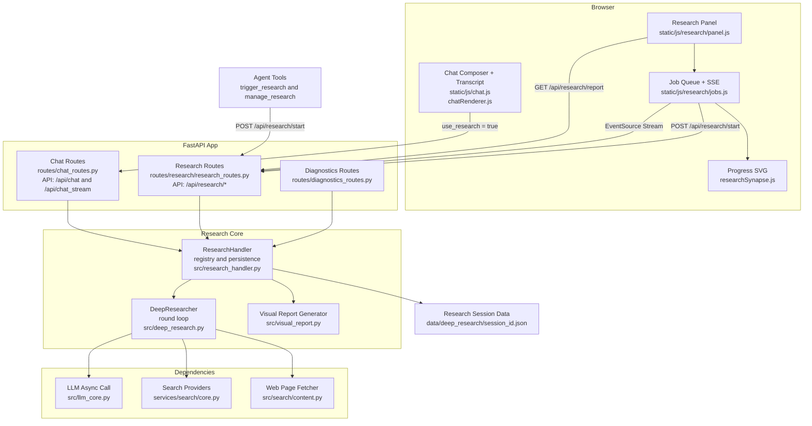
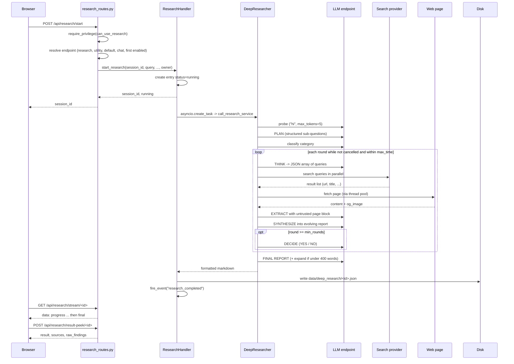
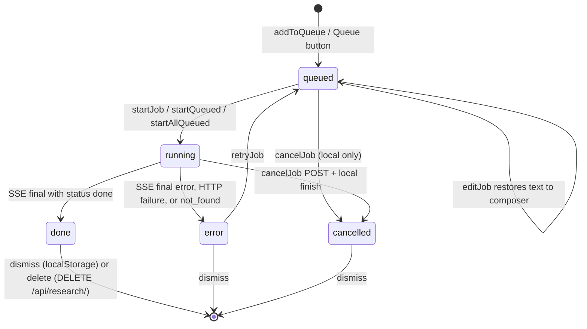
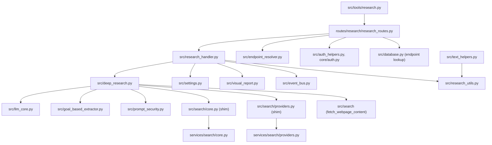

Deep Research is Zephyrus's multi-round web research subsystem. It creates an investigation plan, generates search queries, fetches and extracts evidence from web pages, updates an evolving draft each round, decides when evidence is sufficient, and writes a long-form report with inline citations. The system saves the report as JSON, renders a self-contained HTML visual report, and indexes the result in a searchable Library.

Standard web search answers a single query in one pass. Questions that require cross-source verification, comparison, or synthesis need multiple searches where later queries depend on what earlier queries found.

**Deep Research runs a structured loop:**

```text
Plan -> Think -> Search -> Extract -> Synthesize -> Decide -> Report
```

## Core Capabilities

| Capability | Status | Description |
| --- | --- | --- |
| Multi-round research loop | Implemented | Autonomous planning, search, extraction, synthesis, and stopping cycle |
| Query planning | Implemented | Structured sub-questions and key topics generated before the first search |
| Dynamic query generation | Implemented | Round-by-round queries tailored to current findings with deduplication |
| Search provider chain | Implemented | Searches SearXNG, DuckDuckGo, Brave, Tavily, Google, or Serper with fallbacks |
| Concurrent extraction | Implemented | Parallel page fetching with semaphore-bounded LLM content extraction |
| Content filtering | Implemented | Automated removal of navigation boilerplate, ads, and low-quality summaries |
| Format classification | Implemented | Auto-detection of report styles: product, comparison, how-to, or fact-check |
| Model-guided stopping | Implemented | LLM evaluates report completeness once minimum rounds are reached |
| Length validation | Implemented | Automatic expansion call if the final draft falls below 400 words |
| Follow-up continuation | Implemented | Chat sessions can continue prior research without re-fetching visited URLs |
| Background task runner | Implemented | Async tasks run independently of browser connections and survive page refreshes |
| Live SSE stream | Implemented | Server-Sent Events deliver real-time phase, round, query, and source updates |
| Partial result salvage | Implemented | Timeouts or errors salvage the evolving draft into a usable report |
| User isolation | Implemented | Reports are scoped by owner with 404 responses on cross-user lookups |
| HTML visual report | Implemented | Standalone visual reports with hero images, metrics bar, and source viewer |
| Report Library | Implemented | Searchable storage with filtering, sorting, archiving, and deletion |
| Chat spinoff | Implemented | One-click button to seed a new conversation with a completed report |
| Agent tool integration | Implemented | Tools `trigger_research` and `manage_research` allow autonomous invocation |
| Scheduled research | Implemented | Unattended execution via the Zephyrus task scheduler |

## System Architecture

Deep Research separates orchestration, execution, and presentation into distinct layers:

- **Research Engine (`src/deep_research.py`):** Implements the `DeepResearcher` class. The engine manages the loop, executes prompt templates, parses structured LLM output, calls search providers, and extracts web content. It has no direct knowledge of HTTP, user authentication, or database records.
- **Task Handler (`src/research_handler.py`):** Implements `ResearchHandler`. The handler manages in-memory task registries, schedules background `asyncio` tasks, coordinates fallback paths, handles timeout recovery, formats final reports, and writes JSON files to disk.
- **HTTP Routes (`routes/research/research_routes.py`):** Provides the `/api/research/*` endpoints. It handles session authentication, user permissions, parameter validation, Server-Sent Events streaming, and ownership enforcement.
- **Visual Report Generator (`src/visual_report.py`):** Converts markdown reports and extracted source metadata into standalone HTML documents styled with table of contents, hero images, and source metadata.
- **Frontend Panel (`static/js/research/panel.js`, `jobs.js`, `researchSynapse.js`):** Implements the modal workspace, job queue, real-time status tracker, SVG tree visualization, and Library management.

### Architecture Diagram




### Key Architectural Principles

1. **Background task registry:** `start_research` creates an independent `asyncio.Task` and returns immediately with a session identifier. If the user closes their browser or navigates away, the research run continues on the server. The client reattaches to running jobs via `/api/research/active` and the SSE event stream.
2. **Dual timeout controls:** The engine checks a cooperative `max_time` budget between rounds. An external `research_run_timeout_seconds` ceiling wraps the entire task inside `asyncio.wait_for`.
3. **Fail-open partial salvage:** If an unhandled error or timeout occurs after at least one synthesis round, the system formats the evolving draft and saves it as a completed report rather than failing with an empty output.
4. **Untrusted content framing:** Fetched web page text is sanitized and wrapped using `untrusted_context_message` from `src/prompt_security.py`. Web page text is delivered strictly as user data blocks, never concatenated into system prompts.

## Execution Lifecycle

### Sequence Diagram



### Step-by-Step Flow

<Steps>
  <Step title="1. Admission and privilege check">
    Requests to `/api/research/start` require the `can_use_research` privilege. When called by internal agent tools, the handler validates the `X-Zephyrus-Owner` header against the human user's permissions to prevent privilege escalation.
  </Step>

  <Step title="2. Endpoint resolution">
    The system resolves the model endpoint in order: explicit request override, `research_endpoint_id` setting, `utility` endpoint, default workspace endpoint, chat endpoint, or the user's first enabled endpoint.
  </Step>

  <Step title="3. Endpoint probe">
    Before launching long searches, the handler executes a lightweight probe call (15-second timeout) to verify that the selected model is reachable and credentials are valid. If the probe fails, the system logs an actionable error and halts before consuming search quota.
  </Step>

  <Step title="4. Strategy planning">
    The planner executes `RESEARCH_PLAN_PROMPT`. The model decomposes the question into three to six sub-questions, key topics, and a concrete success criterion. This plan is flattened and injected into all subsequent query generation calls.
  </Step>

  <Step title="5. Category classification">
    A fast zero-temperature classification call identifies whether the target question fits a specific structure: `product`, `comparison`, `howto`, or `factcheck`. The detected category applies dedicated formatting requirements to the final report. General queries fall back to standard synthesis.
  </Step>

  <Step title="6. The round loop">
    Each round executes five sequential phases:
    - **Think:** The model inspects the initial plan, what has been learned so far, and the current round number to generate search queries (four in round 1, three in subsequent rounds).
    - **Search:** The queries execute concurrently against the active provider chain. Results include titles, snippets, and target URLs.
    - **Extract:** Each unseen URL is fetched in a worker thread (up to 15,000 characters). The model extracts a rational, factual evidence, and a brief summary. Extractions run concurrently under an `asyncio.Semaphore`.
    - **Filter:** Summaries matching boilerplate markers (cookie banners, access blocks, empty responses) are dropped.
    - **Synthesize:** The model updates the evolving report by integrating findings from the current round with earlier findings.
  </Step>

  <Step title="7. Model-guided stop decision">
    Once the run reaches `min_rounds` (calculated as `max(2, max_rounds - 2)`), the engine queries the model with `STOP_PROMPT`. If the model responds with YES, the loop terminates early. Otherwise, research continues until reaching `max_rounds` or the time budget.
  </Step>

  <Step title="8. Final report compilation and expansion">
    The engine passes all gathered findings, source citations, and category formatting rules to `FINAL_REPORT_PROMPT`, requesting a structured report of at least 1,500 words with inline markdown links. If the resulting text is shorter than 400 words, an automated expansion pass retries with higher temperature.
  </Step>

  <Step title="9. Persistence and event notification">
    The handler attaches a summary header with duration, round count, query count, and analyzed URLs. It writes the record to `data/deep_research/<session_id>.json`, dispatches the `research_completed` event across the internal bus, and closes the SSE stream.
  </Step>
</Steps>

## Stopping Conditions and Budgets

The research loop stops when any of the following triggers occurs:

| Trigger | Evaluation Point | Behavior |
| --- | --- | --- |
| Cancellation requested | Start of round | Halts immediately and returns the latest evolving draft |
| Cooperative budget exceeded | Start of round | If elapsed time exceeds `max_time`, the loop exits cleanly |
| No queries generated | Query generation | If the model produces no valid queries, the loop exits |
| Consecutive empty searches | Extraction phase | If two consecutive rounds find no new URLs, the loop terminates |
| Model stop decision | End of round | When `round >= min_rounds` and the model returns YES |
| Maximum rounds reached | End of round | Loop terminates when `round == max_rounds` |
| Hard task timeout | Global ceiling | `asyncio.wait_for` fires, salvaging the evolving report if available |

### Default Timeouts

| Call Type | Default | Configurable Setting |
| --- | --- | --- |
| Endpoint probe | 15s | Fixed |
| Category classification | 15s | Fixed |
| Query planning | 90s | `research_planning_timeout_seconds` |
| Query generation | 90s | `research_query_timeout_seconds` |
| Web page extraction | 90s | `research_extraction_timeout_seconds` |
| Report synthesis | 180s | Fixed |
| Final report generation | 180s | Fixed |
| Stop decision | 60s | Fixed |
| Cooperative run budget | 300s | Request body `max_time` (60 to 1800s) |
| Hard wall-clock cap | 1800s | `research_run_timeout_seconds` (0 disables) |

## Data Flow and Storage

### Data-Flow Diagram

```mermaid
flowchart LR
    Q["User question"] --> PLAN["Plan<br/>sub_questions, key_topics"]
    PLAN --> QUERY["Queries<br/>JSON array of strings"]
    QUERY --> SEARCH["Provider chain<br/>results: url + title"]
    SEARCH --> FETCH["fetch_webpage_content<br/>content + og_image"]
    FETCH --> EXTRACT["Extraction LLM<br/>rational / evidence / summary"]
    EXTRACT --> FILTER{"is_low_quality<br/>on summary?"}
    FILTER -->|yes| DROP["discard"]
    FILTER -->|no| FIND["finding"]
    FIND --> SYNTH["Synthesis<br/>window of last 10 findings"]
    SYNTH --> REPORT["Evolving report"]
    REPORT --> STOP{"round >= min_rounds<br/>and LLM says YES?"}
    STOP -->|no| QUERY
    STOP -->|yes| FINAL["Final report LLM<br/>+ expansion if under 400 words"]
    FINAL --> FMT["_format_research_report"]
    FMT --> PERSIST["data/deep_research/&lt;id&gt;.json"]
    PERSIST --> HTML["generate_visual_report"]
```



### Persisted Record Schema

Completed reports are saved to `data/deep_research/<session_id>.json`. The record structure contains:

```json title="data/deep_research/<session_id>.json"
{
  "query": "Evaluate state of WebGPU support across modern browsers in 2026",
  "status": "done",
  "result": "## Research Summary\n- **Duration:** 142s\n- **Rounds:** 4\n- **Queries:** 13\n- **URLs Analyzed:** 18\n- **Model:** qwen2.5:32b\n\n# WebGPU Browser Support in 2026\n...",
  "raw_report": "# WebGPU Browser Support in 2026\n...",
  "sources": [
    {
      "url": "https://caniuse.com/webgpu",
      "title": "Can I use: WebGPU",
      "image": "https://caniuse.com/img/og.png"
    }
  ],
  "raw_findings": [
    {
      "url": "https://caniuse.com/webgpu",
      "title": "Can I use: WebGPU",
      "summary": "Chromium browsers support WebGPU by default on Windows, macOS, and Android. Safari enabled WebGPU in Safari 18."
    }
  ],
  "stats": {
    "Duration": "142s",
    "Rounds": 4,
    "Queries": 13,
    "URLs": 18,
    "Model": "qwen2.5:32b",
    "Search": "searxng",
    "Category": "factcheck"
  },
  "category": "factcheck",
  "started_at": 1773482100.5,
  "completed_at": 1773482242.8,
  "owner": "alice",
  "archived": false,
  "consumed": true,
  "hidden_images": []
}
```

## Client State Machine



## Entry Points

### 1. The Deep Research Panel

The primary interface is the modal overlay accessible from the navigation rail or sidebar.

- **Query input:** Accepts the main topic or investigation question.
- **Rounds setting:** Configurable from Auto (default, up to 20 rounds) down to specific caps.
- **Format selector:** Auto, Product, Comparison, How-to, or Fact-check.
- **Provider selector:** Choose a specific search backend or use system defaults.
- **Endpoint and model selection:** Override the active LLM backend for research tasks.
- **Batch execution:** Staging multiple queries supports both parallel and sequential execution queues.

### 2. Chat Sessions and Continuations

Chat conversations can invoke research directly. When a user asks a question requiring deep research in chat:

1. On the first turn, the model can clarify scope or sub-topics.
2. The server converts conversation history into a targeted research query.
3. The research job runs in the background while the chat stream delivers progress indicators and heartbeats.
4. When finished, the assistant message displays the report, collapsible source citations, and raw findings.
5. Asking follow-up questions in the same session reuses prior findings and avoids re-fetching previously visited URLs.

### 3. Autonomous Agent Tools

Agents running in Zephyrus use two tools declared in `src/tools/research.py`:

- `trigger_research(topic, max_rounds, category, search_provider)`: Initiates a background run and returns a reference link.
- `manage_research(action, session_id, query)`: Supports `list` (recent jobs), `read` (fetch report text), and `delete` (remove stored files).

```json title="Agent Tool Call"
{
  "tool": "trigger_research",
  "arguments": {
    "topic": "Compare ClickHouse and DuckDB for real-time analytical workloads",
    "category": "comparison",
    "max_rounds": 6
  }
}
```

### 4. Scheduled Unattended Tasks

The Zephyrus task scheduler (`src/task_scheduler.py`) runs research jobs on recurring intervals or cron schedules. Scheduled tasks use endpoint resolution scoped to the task owner, run with default limits, save output to `data/deep_research/`, and appear in the user's Library with the `scheduled` category tag.

### 5. HTTP API

The research subsystem exposes 15 dedicated endpoints:

| Method | Endpoint | Description | Access |
| --- | --- | --- | --- |
| `POST` | `/api/research/start` | Launch a background research job | `can_use_research` privilege |
| `GET` | `/api/research/active` | List running research tasks owned by caller | Authenticated user |
| `GET` | `/api/research/status/{id}` | Read real-time status and metrics | Owner check |
| `GET` | `/api/research/stream/{id}` | Server-Sent Events live progress stream | Owner check |
| `POST` | `/api/research/cancel/{id}` | Cancel an active research task | Owner check |
| `POST` | `/api/research/result/{id}` | Fetch results and mark record consumed | Owner check |
| `POST` | `/api/research/result-peek/{id}` | Fetch results without marking consumed | Owner check |
| `GET` | `/api/research/report/{id}` | Render standalone HTML visual report | Owner check |
| `GET` | `/api/research/library` | Paginated search, sort, and filter of reports | Owner scoped |
| `GET` | `/api/research/detail/{id}` | Read raw persisted JSON document | Owner check |
| `POST` | `/api/research/{id}/archive` | Toggle report archived flag | Owner check |
| `DELETE` | `/api/research/{id}` | Delete report JSON file from disk | Owner check |
| `POST` | `/api/research/spinoff/{id}` | Create new chat session primed with report | Owner check |
| `POST` | `/api/research/{id}/hide-image` | Hide specific image URL from visual report | Owner check |
| `POST` | `/api/research/{id}/unhide-images` | Restore all hidden images in visual report | Owner check |

#### Example: Start and Stream

```bash title="Start Research"
curl -X POST http://localhost:7000/api/research/start \
  -H "Content-Type: application/json" \
  -b "session=<auth-cookie>" \
  -d '{
    "query": "Evaluate state of WebGPU support across modern browsers in 2026",
    "max_rounds": 6,
    "category": "factcheck"
  }'
```

```json title="Response"
{
  "session_id": "rp-3a8f19c0b2d4",
  "status": "running",
  "query": "Evaluate state of WebGPU support across modern browsers in 2026"
}
```

```bash title="Listen to Progress Stream"
curl -N http://localhost:7000/api/research/stream/rp-3a8f19c0b2d4 \
  -b "session=<auth-cookie>"
```

```text title="SSE Stream Output"
data: {"phase": "probing", "model": "qwen2.5:32b", "status": "running"}
data: {"phase": "planning", "status": "running"}
data: {"phase": "searching", "round": 1, "queries": 4, "query_preview": "WebGPU browser support 2026 status", "status": "running"}
data: {"phase": "reading", "url": "https://caniuse.com/webgpu", "title": "WebGPU support", "status": "running"}
data: {"status": "done", "final": true}
```

## Visual Reports and the Library

### HTML Visual Reports

Every completed research run can be rendered as a standalone, presentation-grade HTML visual report via `GET /api/research/report/{id}`.

- **Title extraction:** The generator extracts the first markdown heading or falls back to the research query.
- **Typography and structure:** Promotes single bold lines to section headings when markdown lacks `##` structure, extracts table-of-contents anchor tags, and formats code blocks.
- **Image selection:** Scrapes high-resolution Open Graph images from cited pages. Skips `.svg`, `.ico`, `.gif`, and logo files. Selects the first image as the hero banner, distributes other images across section breaks, and keeps remaining images in a spare pool for in-page rerolling.
- **Metrics banner:** Renders an overview bar displaying Duration, Rounds, Queries, URLs Analyzed, Model, and Search Provider.
- **Interactive source drawer:** Collapsible panel with per-domain badges displaying page titles, target URLs, and extracted findings.
- **Image curation:** Users can hide irrelevant images via the visual report interface (`/hide-image`), with a restoration button available when hidden images exist.
- **Exporting:** Integrated toolbar supports one-click `Save as PDF` (clean print stylesheet) and `Download HTML`.

### The Research Library

The Library tab organizes saved reports for quick access and historical retrieval:

- **Filter and search:** Substring search against queries and report bodies, with category filters.
- **Sorting:** Sort by recency (`newest`, `oldest`), duration (`duration`), or source density (`most-messages` sorts by source count).
- **Archiving:** Toggle archive status to declutter active views without deleting files from disk.
- **Deletion:** Permanent unlinking of the target JSON file from `data/deep_research/`.

## Prompt Contracts

The engine relies on seven prompt templates. There is no proprietary function calling or JSON mode flag required; prompts specify explicit schemas in text, and custom parsers extract the structured results.

| Template | Role | Sampling | Output Contract | Parser |
| --- | --- | --- | --- | --- |
| `RESEARCH_PLAN_PROMPT` | User | temp 0.3, 1024 tokens | JSON object with `sub_questions`, `key_topics`, `success_criteria` | Lenient JSON parser |
| Classification prompt | User | temp 0.0, 20 tokens | One token: `product`, `comparison`, `howto`, or `factcheck` | Exact match scanner |
| `QUERY_GEN_PROMPT` | User | temp 0.5, 4096 tokens | JSON array of search strings | `_parse_json_array` |
| `EXTRACTOR_SYSTEM` | User | temp 0.2, 2048 tokens | JSON object with `rational`, `evidence`, `summary` | `_parse_json_object` with raw fallback |
| `SYNTHESIZE_PROMPT` | User | temp 0.3, max tokens | Updated long-form markdown report | Thinking-block stripper |
| `STOP_PROMPT` | User | temp 0.1, 128 tokens | `YES` or `NO` followed by reasoning | Leading-token validator |
| `FINAL_REPORT_PROMPT` | User | temp 0.3, max tokens | Markdown report, minimum 1500 words, inline citations | Word count validator (triggers expansion if under 400 words) |

<Callout title="Date context injection" type="info">
  To prevent models from defaulting to their pre-training cutoff years when generating search queries, `RESEARCH_PLAN_PROMPT` and `QUERY_GEN_PROMPT` automatically inject `current_date_context()`. This ensures query strings target the current year and real-world timelines.
</Callout>

## Configuration Reference

Settings are stored in `data/settings.json` and configurable in the Settings interface:

| Key | Type | Default | Description |
| --- | --- | --- | --- |
| `research_endpoint_id` | string | `""` | Dedicated endpoint ID for research. Empty string uses the standard fallback chain |
| `research_model` | string | `""` | Model name override for research tasks |
| `research_search_provider` | string | `""` | Provider for research searches (overrides general `search_provider`) |
| `research_max_tokens` | integer | `16384` | Maximum tokens for synthesis and final report generation |
| `research_extraction_timeout_seconds` | integer | `90` | Per-page extraction timeout (clamped between 15 and 3600 seconds) |
| `research_planning_timeout_seconds` | integer | `90` | Timeout for the initial planning call |
| `research_query_timeout_seconds` | integer | `90` | Timeout for round query generation |
| `research_extraction_concurrency` | integer | `3` | Max simultaneous page extractions (clamped between 1 and 12) |
| `research_run_timeout_seconds` | integer | `1800` | Hard ceiling for a research run. Set to `0` to disable the ceiling |
| `search_provider` | string | `"searxng"` | Global default search provider |
| `search_fallback_chain` | list | `["duckduckgo"]` | Providers called sequentially when the primary provider returns no results |
| `search_safesearch` | string | `"strict"` | SafeSearch level passed to providers supporting content filters |

### Engine Constants

Four core parameters are fixed within the engine:
- `max_urls_per_round = 3`: Maximum new URLs fetched per search query in each round.
- `max_content_chars = 15000`: Character truncation threshold for fetched web pages.
- `max_empty_rounds = 2`: Number of consecutive empty rounds permitted before terminating search.
- `synthesis_window = 10`: Number of recent findings formatted directly into each synthesis prompt.

## Module Dependencies



## Security, Isolation, and Privacy

### Access Control and Multi-Tenancy

- **Route protection:** All `/api/research/*` routes verify user identity via `_require_user`. When authentication is enabled, requests require valid session credentials.
- **Owner isolation:** Every persisted JSON file records the creator's username in the `owner` field. Library listings, detail views, deletion requests, and archive toggles filter records strictly by owner. Cross-owner access returns `404 Not Found` rather than `403 Forbidden` to avoid confirming the existence of other users' reports.
- **Endpoint scoping:** A requested `endpoint_id` must resolve to an endpoint visible to the caller (owned by the user or shared system-wide). This prevents users from accessing private credentials configured by other accounts.
- **Filesystem sandboxing:** Session identifiers must strictly match `^[A-Za-z0-9-]{1,128}$`. Path helpers verify that candidate files resolve inside `data/deep_research/` before reading or writing.

### Prompt Injection Defenses

Web pages fetched during research contain untrusted third-party text. The subsystem applies three defenses:

1. **Role separation:** Extraction prompts send the extraction task instructions as the first user message, while the fetched page body is passed as a separate user message. Untrusted page text is never inserted into system instructions.
2. **Context sanitation:** Page text passes through `untrusted_context_message("webpage", content)`. This helper escapes delimiters and wraps untrusted input in explicit data markers.
3. **Model output boundary:** The resulting report is treated as untrusted markdown. Client renderers escape raw HTML, sanitize source links, and prevent script execution.

### Data Retention

- **Disk storage:** Completed reports reside in `data/deep_research/<session_id>.json`. The file contains the final report, source URLs, titles, extracted summaries, and execution metrics. Raw web page bodies and intermediate draft iterations are discarded.
- **Memory retention:** The in-memory task entry in `ResearchHandler._active_tasks` retains run state until released. Completed entries expire from memory 3,600 seconds after completion.
- **User deletion:** Deleting a user account removes authentication credentials, but does not automatically delete stored research JSON files. Deletion of user data files requires an administrative storage sweep or direct file removal.

## Performance and Tuning Guide

### Resource Demands

Each research run executes multiple LLM calls:
- 1 probe call
- 1 planning call
- 1 classification call (initial run only)
- Per round: 1 query generation call, 1 extraction call per fetched URL (typically 9 to 12 calls), 1 synthesis call, and 1 stop evaluation call (from `min_rounds` onward)
- 1 final report call (with an optional expansion call)

For an 8-round run, the engine can execute between 30 and 60 individual LLM calls.

### Operational Tuning

<Callout title="Local GPU tuning" type="tip">
  When running against a local model server (such as Ollama or vLLM on a single GPU), set `research_extraction_concurrency` to `1` or `2`. Local servers serialize requests on one GPU; high concurrency queues requests and triggers extraction timeouts.
</Callout>

| Operational Symptom | Recommended Adjustment |
| --- | --- |
| Extractions repeatedly time out | Increase `research_extraction_timeout_seconds` to 180s or reduce extraction concurrency to 1 |
| Local server slows down or drops requests | Reduce `research_extraction_concurrency` to 1 or 2 |
| Reports are cut off mid-paragraph | Increase `research_max_tokens` from 16384 to 32768 |
| Runs end prematurely after 2 rounds | Increase `max_time` in the request body (default is 300s) |
| Search returns empty results | Configure a reliable provider in `research_search_provider` and verify `search_fallback_chain` |
| Long runs terminate at exactly 30 minutes | Increase `research_run_timeout_seconds` or set to `0` to disable the hard cap |

## Developer Integration and Extension

### Python Programmatic Access

You can query existing research records or initiate runs directly in Python:

```python
from src.research_handler import ResearchHandler

handler = ResearchHandler()

# Retrieve stored report and sources by session ID
result = handler.get_result("rp-3a8f19c0b2d4")
sources = handler.get_sources("rp-3a8f19c0b2d4")
html_doc = handler.get_report_html("rp-3a8f19c0b2d4")
```

### Adding a Custom Report Format

To introduce a new report format:

1. Add a prompt template mapping to `CATEGORY_PROMPTS` in `src/deep_research.py`.
2. Update `_classify_category` in `src/deep_research.py` to recognize the new category keyword.
3. Add custom CSS rules to `_category_css` in `src/visual_report.py`.
4. Add an `<option>` element to `#research-category` in `static/js/research/panel.js`.

### Adding a Search Provider

1. Declare the provider implementation in `services/search/providers.py`.
2. Register the provider name in `_build_provider_chain` within `services/search/core.py`.
3. Add the provider key to the `searchProviders` array in `static/js/research/panel.js`.

## Troubleshooting

### Search returns "Search unavailable" immediately

- **Cause:** Every provider in the fallback chain returned zero results. This frequently occurs when a local SearXNG container is reachable but upstream search engines block its outgoing requests.
- **Fix:** Check SearXNG engine health, or configure DuckDuckGo or Tavily directly in `research_search_provider`.

### "Model requires an API key" error

- **Cause:** The initial endpoint probe received a 401 Unauthorized or 403 Forbidden response.
- **Fix:** Verify the API key in Settings -> Endpoints for the assigned research endpoint.

### Research stops after 5 minutes despite setting 20 rounds

- **Cause:** The cooperative `max_time` budget defaulted to 300 seconds and was reached before the round cap.
- **Fix:** Pass an explicit `max_time` parameter in the API request or panel settings (e.g. 1200 seconds).

### Completed run displays zero sources

- **Cause:** The extraction model returned malformed responses that could not be parsed as JSON, and raw summaries failed quality checks.
- **Fix:** Use an extraction model with strong JSON formatting performance (such as Qwen 2.5 32B or modern cloud models).

### Job disappears after restarting the application

- **Cause:** Active research tasks run as in-memory Python tasks. If the server process restarts mid-run, active tasks cannot resume. Completed runs are safe because they are written to disk as JSON upon completion.
- **Fix:** Restart interrupted jobs from the panel queue or API.
